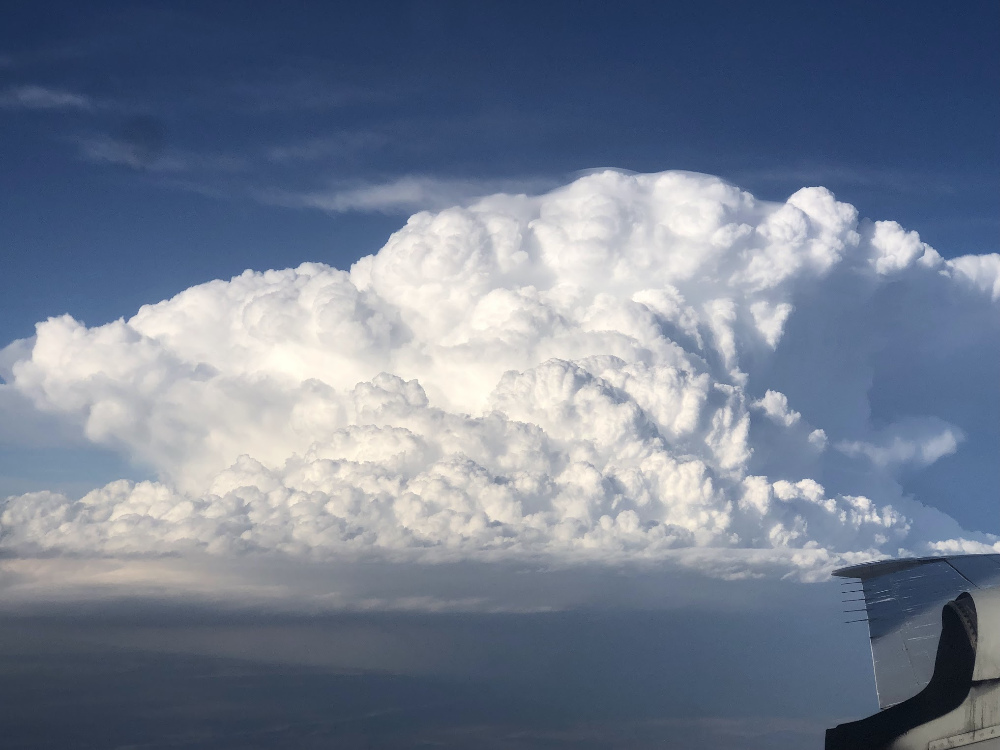
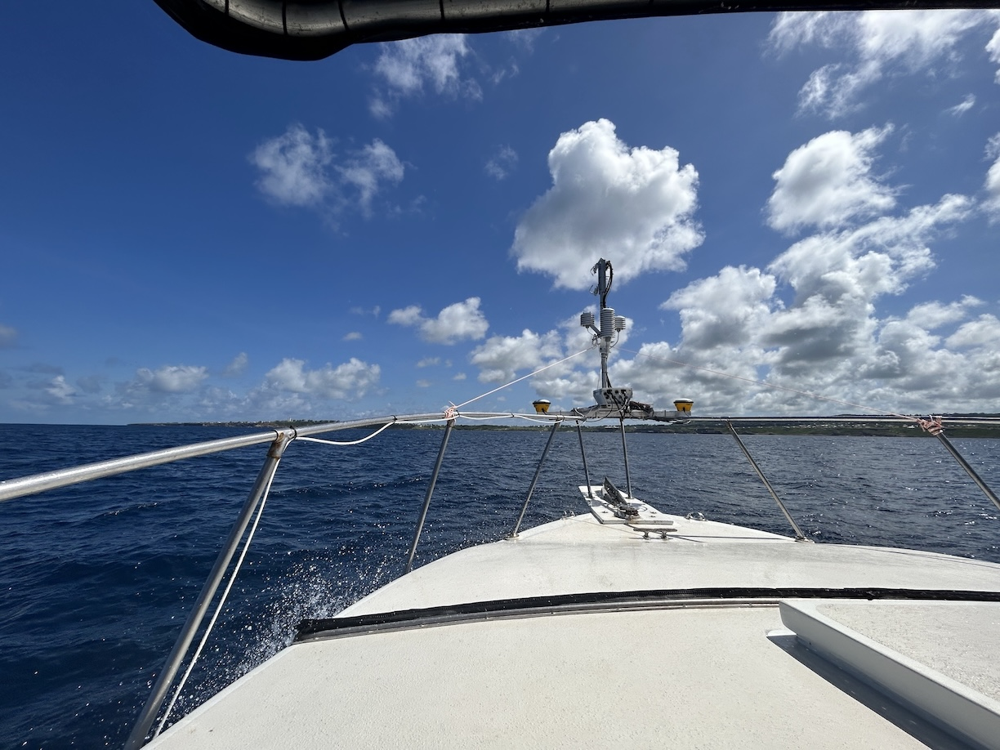
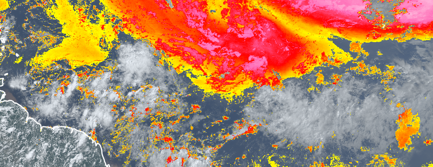
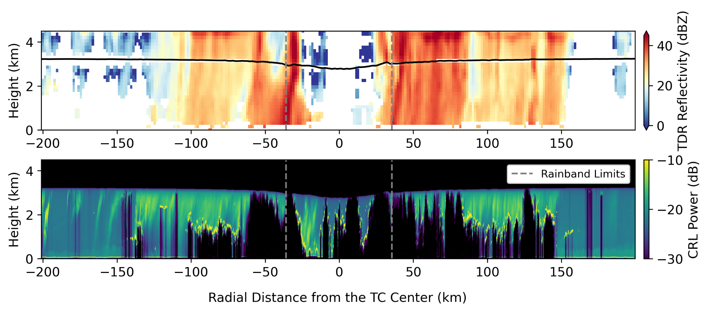

Working at the intersection of atmospheric observations and modeling, improving severe weather prediction

  <figure class="tile--hero tile--sky"></figure>
  <figure class="tile--tall tile--balloon"></figure>
  <figure class="tile--wide"></figure>
  <figure class="tile--wide"></figure>
  <figure class="tile--full tile--fit"></figure>

